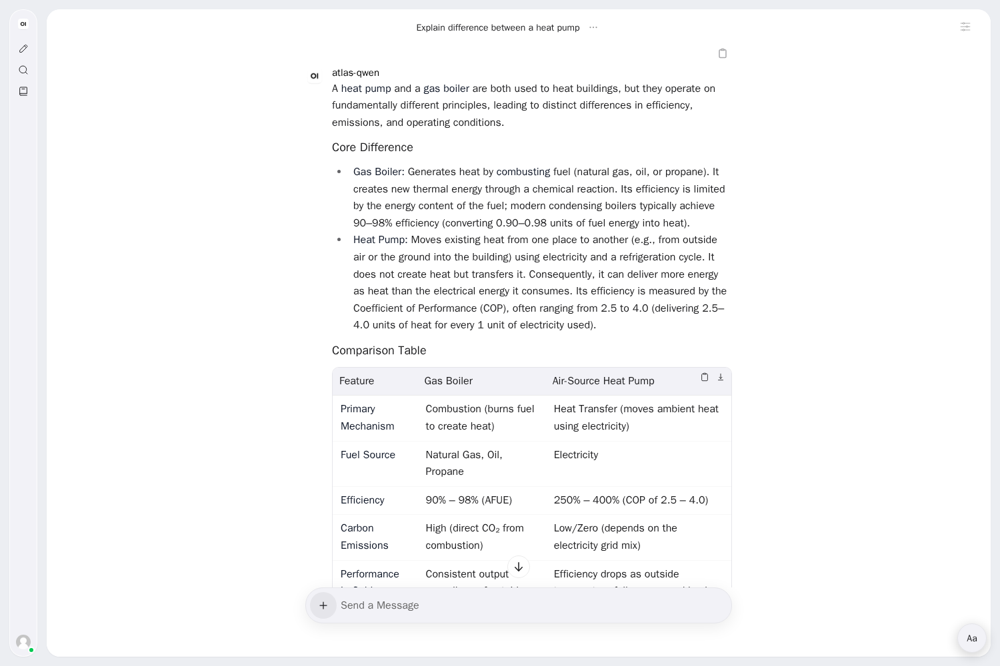
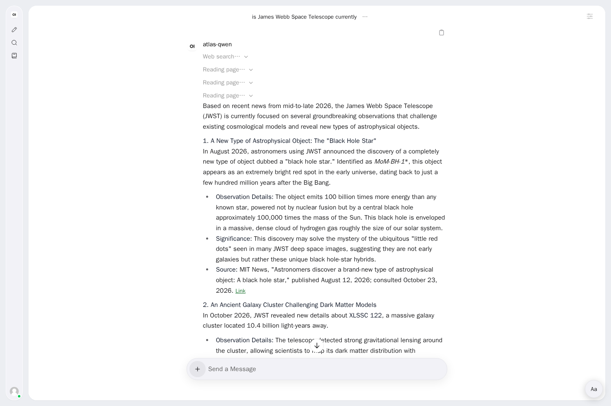
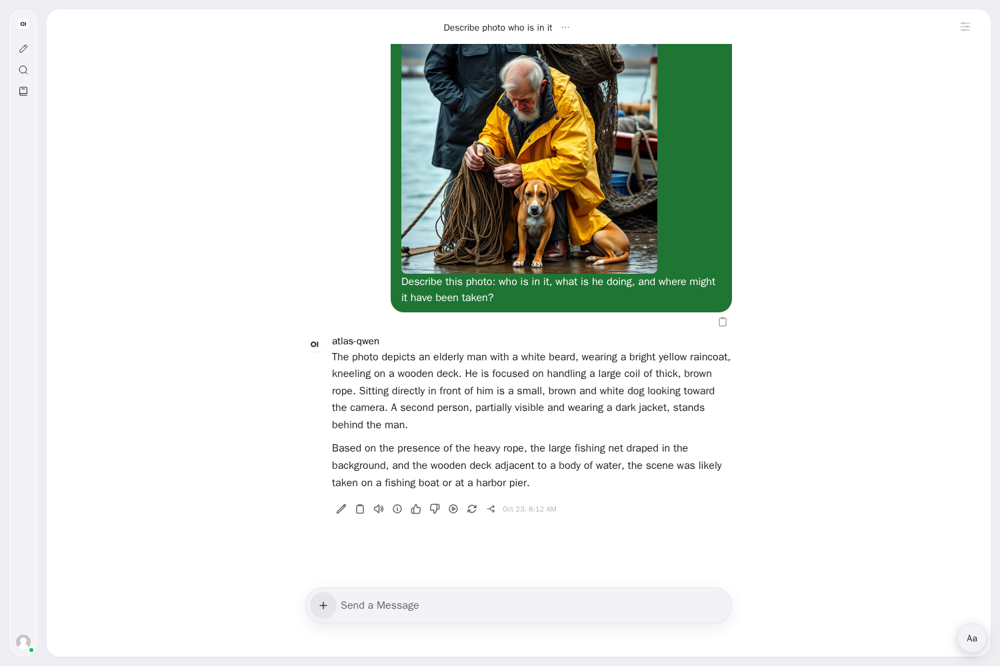
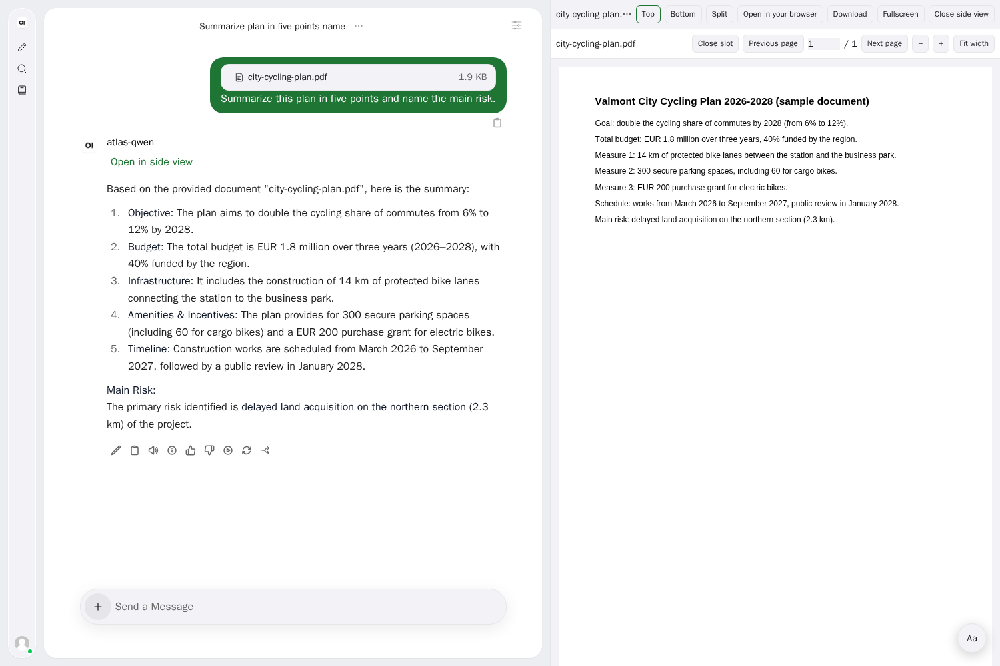
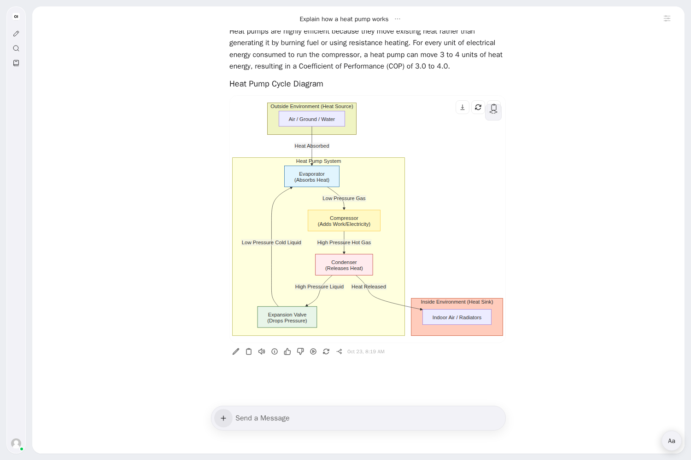
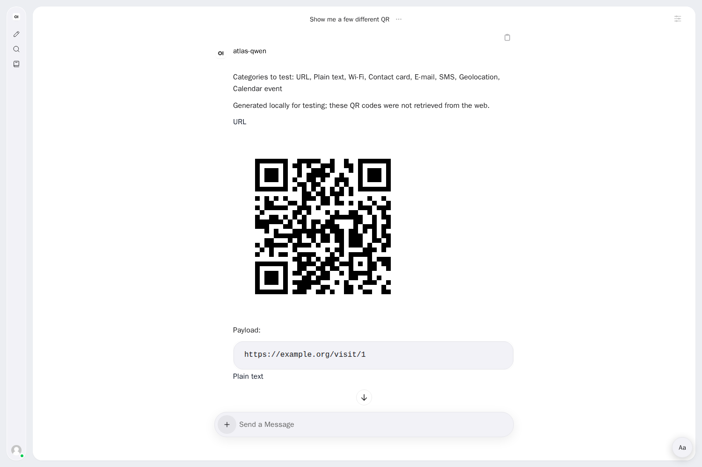
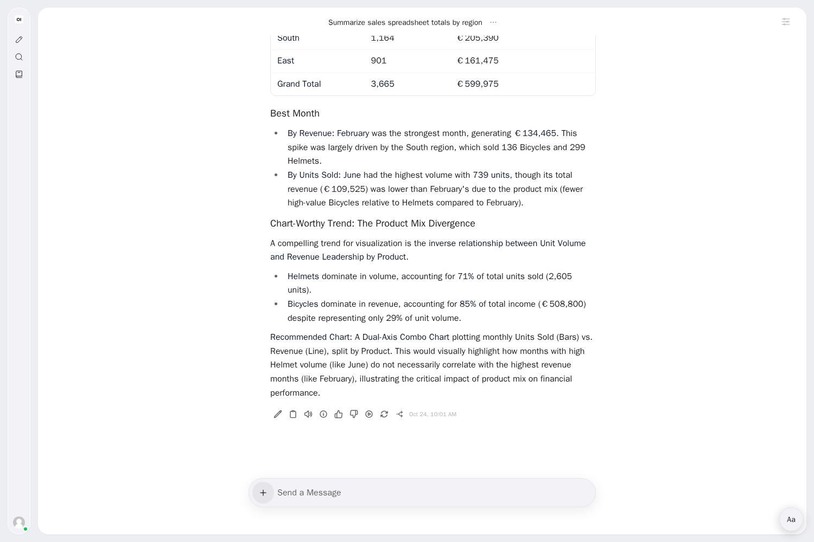
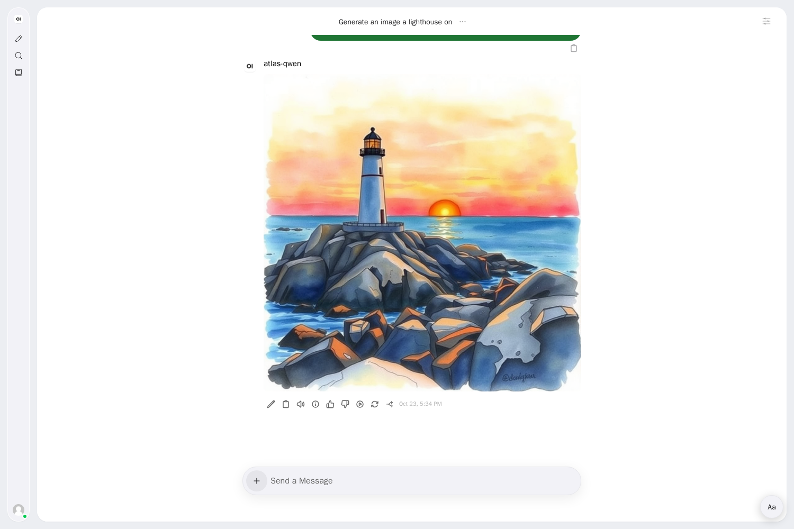

# ATLAS

<picture>
  <source media="(prefers-color-scheme: dark)" srcset="assets/brand/svg/atlas-logotype-dark.svg">
  
</picture>

I started Atlas because I want to keep control over our data, something Claude
and ChatGPT do not allow in the way I need. My aim is an agentic AI assistant
platform close to their performance while enabling digital sovereignty.

I am building Atlas as an open-source, open and transparent, extensible platform,
designed for open-weight models and frugal routing. It offers an OpenAI-compatible
API and an MCP client. I want people to run it on their own infrastructure or
use on-demand services. Atlas was first built on Scaleway's on-demand models, with
image generation on a GPU rented by the hour, and it plugs easily into other
OpenAI-compatible providers. The Docker quick start includes ready-made presets
for Hetzner, Mistral, OVHcloud and Scaleway, and an experimental local Ollama option.

Gaël Duval

## More than an interface to an open-weight model

Atlas is not a thin chat window over one open-weight model. Most of its work happens
between the question and the model, with two goals: get the best answer an open model
can give, and carry real work with AI beyond a single conversation.

**Strategies that raise answer quality**

- **Routing by task.** A model gateway assigns a model to each role (conversation,
  code, image understanding, judging) and switches to an alternate model when the
  primary one fails or times out.
- **Grounded answers.** Web answers are built from fetched pages, not from search
  snippets alone. A source is cited only if it was actually retrieved in the
  conversation, and a quota or budget refusal is reported as such, never disguised
  as a provider outage.
- **Checks before delivery.** Generated files and diagrams are validated before they
  reach the user (for example, malformed SVG is repaired). In Code mode, a change
  counts as done only when its tests actually ran and passed.
- **Procedures and memory.** Approved skills bring task-specific procedures into a
  turn. User memory keeps stated preferences across conversations and never enters
  a project.
- **Measured, not assumed.** Multilingual golden suites, truthfulness cases, a
  private held-out set and recorded journeys track quality from one release to the
  next.

**Managing projects that use AI**

- Projects gather documents, instructions and conversations in one place, with
  roles for sharing inside an organization and private conversations by default.
- Project work runs multi-step tasks over the project's files and produces
  deliverables (documents, spreadsheets, presentations) with the sources they used.
- In Code mode, Atlas works in a disposable workspace and proposes changes that you
  approve before a pull request is opened.
- Spending is capped per user and per day; API keys carry their own scopes and
  daily limits.

## Features

✅ available · 🟡 partial or in progress · 🔜 planned · ❌ not offered.
Availability depends on configuration; Code mode is an owner preview.

| Feature (short description) | Atlas | ChatGPT | Claude |
| --- | --- | --- | --- |
| General conversational assistant | ✅ | ✅ | ✅ |
| Advanced answers with web search and cited sources | ✅ | ✅ | ✅ |
| Image analysis (photos, screenshots) | ✅ | ✅ | ✅ |
| Image generation | ✅ (FLUX on an on-demand GPU) | ✅ | ❌ (diagrams and SVG only) |
| PDF and office documents analysis (including scanned PDFs) | ✅ | ✅ | ✅ |
| Generated files (presentations, spreadsheets, documents) | ✅ | ✅ | ✅ |
| Diagrams and side view for documents | ✅ | ✅ (canvas) | ✅ (artifacts) |
| Voice: dictation and read aloud | ✅ | ✅ | ✅ |
| Real-time voice conversation | 🔜 | ✅ | ✅ |
| Projects with documents and instructions | 🟡 (document projects; unified project mode planned) | ✅ | ✅ |
| Agentic work on files and code | 🟡 (Code mode, owner preview) | ✅ | ✅ |
| MCP connectors | 🟡 (MCP client, stdio) | ✅ | ✅ |
| API | ✅ OpenAI-compatible | ✅ (OpenAI API) | ✅ (Anthropic API) |
| Self-hosting and choice of models | ✅ | ❌ | ❌ |
| Data stays on infrastructure you choose | ✅ (includes configured inference and search providers) | ❌ | ❌ |
| Languages | French, English, German, Spanish, Italian tested (others work through the models) | many | many |

Comparison as of October 2026.

## Try it and use it: how to start

### ⏱️ Only have 10 minutes? Try the Docker install

```bash
git clone https://github.com/leag1234/atlas-ai-platform.git
cd atlas-ai-platform
./atlas setup
```

Setup asks you to pick an inference provider and paste its API key (Hetzner is free
during its experiment), then builds and starts the containers. Open
http://localhost:3000 and create the first administrator account. Use
`./atlas setup --http-port 3100` to choose another port. Step by step:
[Docker quickstart](docs/quickstart.md).

For the OpenAI-compatible developer API, use `./atlas setup --api` (or
`./atlas setup --reconfigure --api` for an existing installation), then
`./atlas api-key create editor --daily-requests 20`. This prints the path to a
mode-600 key file; only an explicit `--show` prints the key. Point your client at
`http://127.0.0.1:3001/v1`, read that file as its API key, and use model
`atlas-code`. Manage keys with `./atlas api-key list` and
`./atlas api-key revoke editor`. The API uses your selected provider; it is opt-in
and creates no key automatically. Set `ATLAS_API_PORT` for another port or
`ATLAS_API_BIND=0.0.0.0` to opt into listening on all interfaces.

**Limitations of the Docker install.** It is meant for evaluation:

- **No image generation.** Generating images needs a GPU host (full installation).
- **No Code mode, no speech** (voice input and read-aloud), and **no document
  terminal**, so Atlas cannot produce Word, Excel or PowerPoint files.
- **No HTTPS.** It serves plain HTTP; put your own reverse proxy in front before
  exposing it beyond your machine.
- **Image understanding depends on the provider.** Photos and scanned PDFs need a
  vision model: included with the Hetzner, Scaleway and OVHcloud presets, not
  with Mistral.
- **Web search can be throttled.** The bundled SearXNG relays queries to public
  search engines, which may rate limit it, especially from cloud servers.
- **Not hardened** for multi-organization hosting.

Requests for a missing feature get a clear "not enabled on this installation"
answer.

Set `ATLAS_REMOVE_OPEN_WEBUI_SUFFIX=1` only for a deployment with at most 50 users in any rolling 30-day period, written permission from Open WebUI, or an enterprise license.

### 🚀 Get the full benefits: full installation

Image generation on your own GPU, Code mode, speech, generated office documents,
HTTPS and administration. Allow about 20 to 30 minutes for the setup itself, plus
model downloads and GPU provisioning:
[full stack installation](docs/installation.md).

## Screenshots

| | |
| --- | --- |
|  |  |
| **Chat**: structured answers with tables. | **Web search**: answers built from fetched pages, with clickable sources. |
|  |  |
| **Image understanding**: describe and analyse a photo. | **Documents**: summarise a PDF and read it in the side view. |
|  |  |
| **Diagrams**: explanations with rendered flowcharts. | **Tools**: QR codes and other outputs generated locally. |
|  |  |
| **Spreadsheets**: totals and trends computed from the file. | **Image generation**: on a GPU rented by the hour (full installation). |

## Next

- Unified Project mode in the spirit of Claude Cowork, including the Code mode.
- Atlas Desktop for local folders with a clear view of what stays local.
- Skills in the SKILL.md format.
- Admin-level image safety settings.
- Multi-organization accounts.
- Real-time voice.
- More inference providers.

## How it works

Open WebUI is the base of the web interface. An orchestrator handles conversation,
documents, tools and budgets; a model gateway routes inference. Retrieval uses
PostgreSQL and CPU embeddings. Chat uses on-demand models by default; realistic
image generation starts an ephemeral GPU.

See the [installation guide](docs/installation.md), [MCP guide](docs/mcp.md) and
[API compatibility guide](docs/api-compatibility.md) for configuration and supported
interfaces. [Deployment architectures and costs](docs/20-deployment-architectures-and-costs.md)
compares on-demand inference with dedicated H100 servers, with gross cost figures.

## Models and inference

Defaults come from [routing.yaml](services/model-gateway/routing.yaml) and
[pricing.yaml](services/model-gateway/pricing.yaml). Rates below are recorded
configuration from September 2026, in EUR per million input/output tokens excluding
tax, not current quotes. Environment settings and availability can change the model.

| Model | Use | Inference service | Recorded cost |
| --- | --- | --- | --- |
| `qwen3.5-397b-a17b` | Main text, escalation; `atlas-qwen` | Scaleway on-demand API | 0.60 input / 3.60 output |
| `glm-5.2` | Code role, Code mode, corpus judge; `atlas-glm` | Scaleway on-demand API | 1.80 / 5.50 |
| `llama-3.3-70b-instruct` | Optional truthfulness judge | Scaleway on-demand API | 0.60 / 3.60 conservative fallback in [judge.py](evals/truthfulness/judge.py); absent from pricing.yaml |
| `deepseek-v4-flash-0731` | Fast role; `atlas-deepseek` | Scaleway on-demand API | 0.40 / 0.80 |
| `gemma-4-26b-a4b-it`; fallback `pixtral-12b-2409` | Attached-image understanding | Scaleway on-demand API | 0.25 / 0.50; fallback 0.20 / 0.20 |
| `lightonocr-3-0.8b` | Scanned PDF OCR | Scaleway on-demand API | 2.20 / 0.00; page reservations also apply |
| `qwen3-embedding-8b` | Configured serverless embedding role; not the current project retrieval path | Scaleway on-demand API | 0.10 / 0.00 |
| `paraphrase-multilingual-MiniLM-L12-v2` + `mmarco-mMiniLMv2-L12-H384-v1` | Current corpus/project embeddings and reranking | Application host, CPU | Host cost; no provider token charge |
| FLUX.1 schnell (`unsloth/FLUX.1-schnell`, pinned revision) | Realistic image generation | Dedicated Scaleway GPU, started on demand | Inventory estimate: L4 about 0.79 EUR/hour plus storage; type/rate depend on availability |
| Qwen3-30B-A3B through `LOCAL_MODEL` | Optional local simple-chat engine | Dedicated GPU; not required by the default CPU/serverless stack | Hourly GPU cost, not free inference |
| Whisper small (`Systran/faster-whisper-small`) | Dictation | Application host, CPU | Host cost |
| Piper voices for English, French, German, Spanish and Italian | Read aloud | Application host, CPU | Host cost |

Provider presets and a custom OpenAI-compatible endpoint are available through `./atlas setup`; see the [quickstart](docs/quickstart.md).

The full inventory, with the dedicated GPU and the alternatives considered, is in [docs/16-models-and-inference-inventory.md](docs/16-models-and-inference-inventory.md).

## Limitations

- GPU shortages can prevent image generation; startup can take up to 15 minutes.
- Open-model quality varies on long, multi-step tasks. Invented facts about named
  entities remain a known weakness; citations do not guarantee factual accuracy.
- Tavily and SerpAPI are US companies: web search through them is a known gap with
  the sovereignty goal. Self-hosted SearXNG is supported, with external upstream engines.
- Attachment, OCR, context and request budgets can limit coverage. Code mode is
  an owner preview; unified projects and multi-organization accounts are planned.

## Security

Code workspaces use disposable containers with no network, a read-only root and
resource limits. The document terminal has separate containment and its own API
key. MCP writes require single-use confirmation; ordinary inference and search
do not. Administrators configure credentials, retention and spending caps.

The optional guest instance uses TLS, Basic authentication and restricted identity
headers. Code execution is restricted, and images require opt-in. Generated file
links grant access to their content. This is a PoC for known guests, not hardened
multi-organization hosting. See [deployment boundaries](infra/stable/README.md)
and [terminal security](runbooks/open-terminal-upstream.md).

## Evaluation

[Multilingual golden suites](evals/README.md), [truthfulness cases](evals/truthfulness/README.md),
[Code tasks](evals/code_tasks/README.md) and recorded HTTP journeys cover different
behaviors. Replay checks regressions; live measurements assess provider quality.

The [stored 15-case comparison](reports/m25-corpus.json), scored on October 13,
2026, averages **6.20 / 6.00 / 4.87** for the three Atlas profiles,
**7.60** for ChatGPT and **7.67** for Claude, out of 10. Exact responding model
versions and reference-answer dates are missing, and the judge shares a model
family with one Atlas profile. These small, single-run results do not establish
general parity. Evaluation needs independent judges, repeated measurements and
better reproducibility; see the [methodology and gaps](reports/M26.md).

## License


Atlas is licensed under the GNU Affero General Public License, version 3 only (AGPL-3.0-only). See [LICENSE](LICENSE). Vendored third-party components keep their own licenses.

---

A project created and maintained by [Gaël Duval](https://gaelduval.com) (creator of Mandrake Linux and /e/OS).
