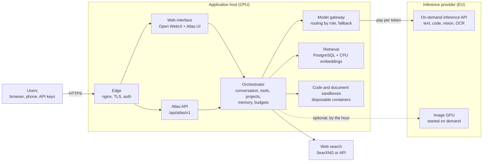
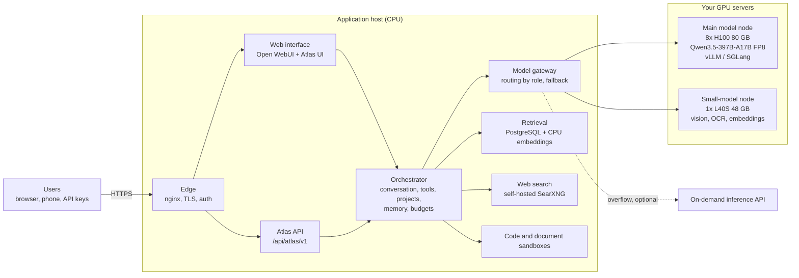

# Deployment architectures and costs

Atlas runs the same application in two inference modes. This page shows both and
gives gross cost figures so that anyone evaluating Atlas can size a deployment.
Figures are orders of magnitude from October 2026, in EUR excluding tax. They are
not quotes: confirm prices with providers before deciding.

## 1. On-demand AI (serverless inference)

The application host runs Atlas; models are called through an OpenAI-compatible
on-demand API (Scaleway by default; Hetzner, Mistral, OVHcloud presets or any
compatible endpoint). You pay per token, nothing when idle.

**Gross costs**

| Item | Gross figure |
| --- | --- |
| Application host (CPU VM, 16 vCPU / 32 GB, storage) | about 100 to 300 EUR per month |
| Average conversation turn (measured on the guest instance, main text model) | about 0.004 EUR median, 0.01 EUR mean, 0.03 EUR for heavy turns (long documents, web research) |
| Light user (about 15 turns a day) | about 3 EUR per month |
| Regular user (about 50 turns a day, two hours of use) | about 10 EUR per month |
| Intensive user (about 150 turns a day, documents and web) | about 65 EUR per month |
| Image generation GPU, when used | about 0.8 EUR per hour while running |

Strengths: no fixed GPU cost, cost follows usage, new models without hardware
changes. Limits: depends on the provider's availability and rate limits; data
leaves your infrastructure for inference (to an EU provider by default).

## 2. On-premise AI (dedicated H100 node)

The same application, with inference served by your own GPUs through an
OpenAI-compatible engine (vLLM or SGLang). The model gateway points to the local
endpoint; nothing leaves your infrastructure.

**Sizing**

| Model role | Memory (FP8 weights) | Minimal hardware |
| --- | --- | --- |
| Main text model, Qwen3.5-397B-A17B | about 400 GB | 8x H100 80 GB (or 4x H200) |
| Code model, GLM-5.2, if kept separate | about 750 GB | 8x H200; does not fit 8x H100 |
| Fast model, DeepSeek-V4-Flash | about 160 GB | 4x H100 (or 2x H200) |
| Vision, OCR, embeddings | about 70 GB | 1x L40S 48 GB (quantized) or 1x H100 |

The recommended on-premise setup consolidates text, code and fast roles on the
main model (one 8x H100 node) plus one L40S. Moving code from GLM to Qwen requires
a new quality measurement.

**Capacity (estimate, to be confirmed by a load test):** one 8x H100 node serves
about 300 simultaneously active users with margin. That is roughly 2,000 to 3,000
registered business users (10 to 15 percent active at peak), or 15,000 to 30,000
registered public users (1 to 2 percent active at peak).

**Gross costs per node (8x H100 + 1x L40S)**

| Option | Gross figure |
| --- | --- |
| Rented GPU servers (Scaleway list price: 8x H100 SXM about 23 EUR per hour, L40S about 1.4 EUR per hour) | about 17,800 EUR per month, running all the time |
| Purchased: 8x H100 server | about 230,000 to 290,000 EUR new, about 180,000 EUR used |
| Purchased: amortization over three years | about 6,500 to 8,000 EUR per month |
| Purchased: hosting (about 10 kW per node, colocation and electricity in Paris) | about 2,500 to 3,500 EUR per month |
| Purchased: total per node | about 9,000 to 11,500 EUR per month |
| Operations (on-call, upgrades, failures), for a small fleet | about one to two people |

At full load, a purchased node costs about 3.5 to 5.5 EUR per regular business user
per month, against about 10 EUR on demand. GPUs are sized for the peak and sit
partly idle at night and on weekends, which erodes that advantage.

## 3. Choosing

Example: a public and business opening with 100,000 public and 10,000 business
registered users (about 2,700 simultaneous users at peak).

| Setup | Monthly cost | Investment |
| --- | --- | --- |
| On demand only | about 90,000 EUR | none |
| Rented GPUs sized for the peak (10 nodes) | about 180,000 EUR | none |
| Purchased GPUs sized for the peak (10 nodes) | about 120,000 EUR with operations | about 2.5 M EUR |
| Hybrid: 4 purchased nodes for the base load, peaks on demand | about 80,000 EUR | about 1 M EUR |

- Start on demand: lowest cost at small and medium scale, no investment.
- Add dedicated GPUs when a stable base load is measured, and keep peaks on demand;
  the model gateway already supports fallback between endpoints.
- Choose on-premise for full sovereignty, guaranteed capacity or isolated
  deployments for organizations that require them, rather than for cost alone.
- H100 dates from 2022; ask for quotes on newer generations before buying, since
  throughput per euro has improved.

See also [models and inference inventory](16-models-and-inference-inventory.md).

Sources (October 2026): Scaleway GPU price list; SGLang and vLLM deployment recipes
for Qwen3.5-397B-A17B; model cards and listings for GLM-5.2 and DeepSeek-V4-Flash;
public H100 server listings and estimates; JLL EMEA data center market study H1 2026.
Per-turn costs are aggregates of the guest instance ledger (October 19 to 28, 2026).
